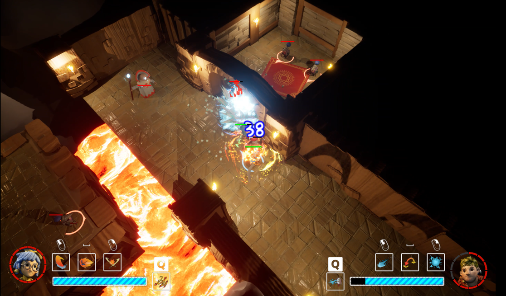
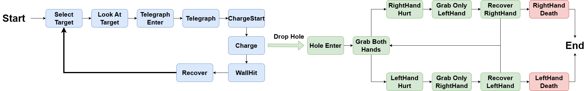
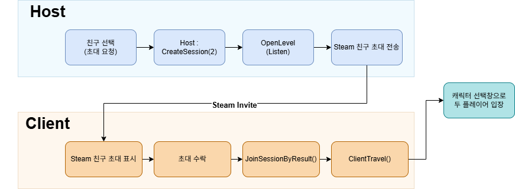
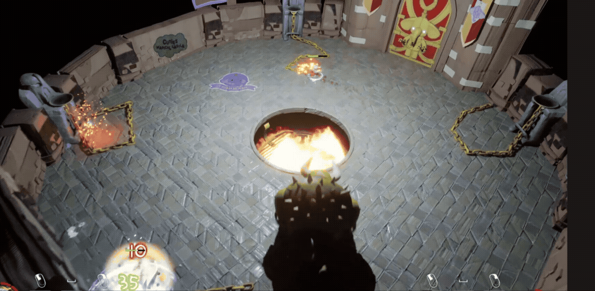
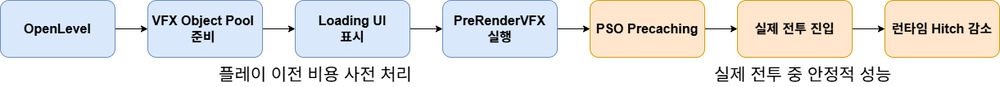
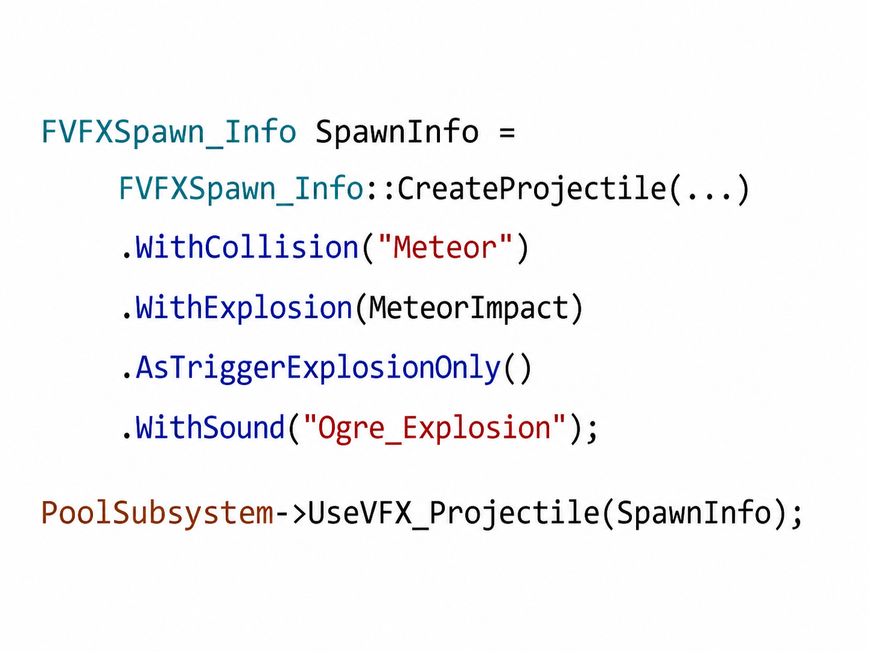
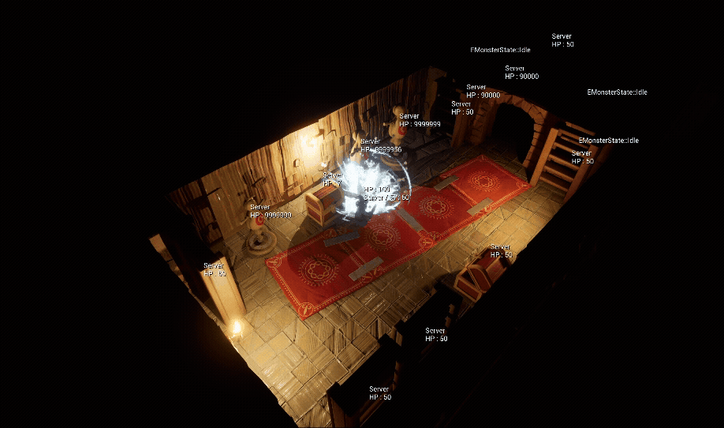
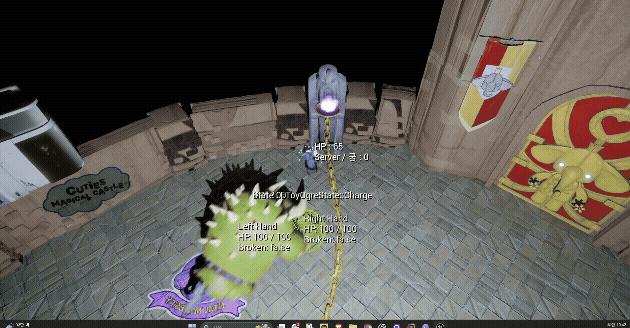
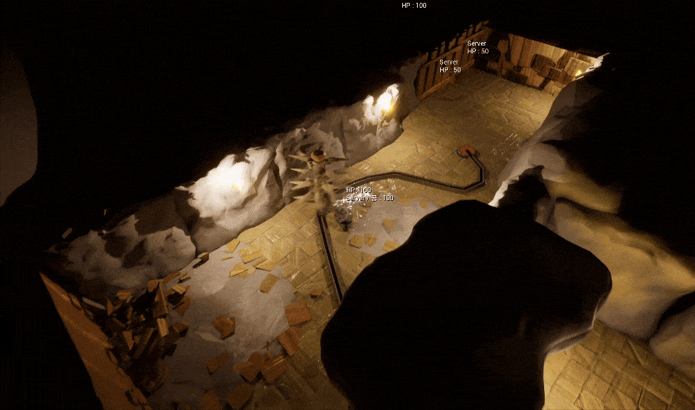
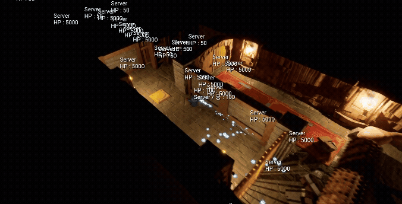

# [Unreal Engine 5] It Takes Two 모작

Unreal Engine 5로 It Takes Two의 Dungeon Crawler 전투 구간을 모작한 2인 협동 액션 어드벤처 프로젝트입니다.

### 팀 프로젝트

- 개발 기간 : 2026.04.15 ~ 2026.05.18
- 개발 인원 : 3명
- 담당 부분 : 네트워크, 몬스터, 맵
- 개발 환경 : Unreal Engine 5, C++, Blueprint, Steam OnlineSubsystem, Niagara
- 플레이 영상 : [YouTube](https://youtu.be/rewH8H63ewM)
- 팀 저장소 : [superajiwon/Unreal5_ItTakesTwo](https://github.com/superajiwon/Unreal5_ItTakesTwo)

# 구현 내용

## 1. State Pattern 기반 ToyOgre 보스 AI

### 문제

돌진, 충돌, 구멍 진입, 양손 피격과 사망까지 조건에 따라 이어지는 보스 행동을 하나의 클래스에서 관리하기 어려웠습니다.

### 결과

- **기본 공격 8개 상태 + 조건 전환 10개 상태**, 총 18개 상태로 행동을 분리했습니다.
- 상태 전환은 서버에서 결정하고, 애니메이션·사운드·카메라 연출은 Multicast로 동기화했습니다.
- 새로운 패턴을 추가할 때 기존 상태 로직에 미치는 영향을 줄였습니다.

| 구성 | 역할 |
| --- | --- |
| `Enter / Tick / Exit` | 상태 진입, 실행, 종료 로직 분리 |
| `HandleAnimNotify` | 애니메이션 시점에 맞춰 충돌과 상태 전환 처리 |
| StateMachine Component | 현재 상태 관리와 다음 상태 전환 |
| Server Authority | 행동 판정은 서버, 연출은 모든 클라이언트에 전달 |

## 2. Steam 친구 초대 기반 2인 협동

Steam 친구 초대만으로 Host의 Listen Server에 참가할 수 있도록 세션 흐름을 구성했습니다.

| 순서 | 처리 |
| --- | --- |
| **1. Host 세션 생성** | 친구 선택 후 2인 세션을 만들고 `OpenLevel(Listen)` 실행 |
| **2. Steam 초대** | 저장한 Steam ID로 친구 초대 전송 |
| **3. Client 참가** | 초대 수락 후 `JoinSessionByResult()` 실행 |
| **4. 레벨 이동** | `ClientTravel()`로 캐릭터 선택 레벨에 진입 |

## 3. 서버 권한 기반 멀티플레이 동기화

### 문제와 결과

| 문제 | 해결 | 결과 |
| --- | --- | --- |
| 구멍 진입 시 Actor 위치와 보이는 Mesh 위치가 어긋남 | 서버가 진입을 판정하고, 클라이언트 Mesh 위치를 Multicast로 보정 | Host와 Client에서 동일한 위치로 표시 |
| 서버에서만 상태를 실행해 Client 연출이 누락됨 | 판정과 연출을 분리하고 Montage·Sound·VFX를 Multicast로 전달 | 보스 상태와 1회성 연출 동기화 |
| 레벨 이동 시 Host만 다음 맵으로 이동함 | `ServerTravel`과 `SeamlessTravel`을 적용하고 로딩 후 HUD와 입력 복구 | 두 플레이어가 함께 이동하고 플레이 상태 복원 |

  

## 4. Niagara VFX 첫 재생 Hitch 최적화

### 문제

Niagara VFX가 처음 재생될 때 Shader·PSO 생성과 초기화 비용이 한 프레임에 몰려 순간적인 끊김이 발생했습니다.

### 결과

| 측정 항목 | 적용 전 | PreRender + PSO 적용 후 |
| --- | ---: | ---: |
| FPS | 28.55 | **36.72** |
| Frame Time | 28.45ms | **25.33ms** |
| Game Thread | 26.88ms | **8.62ms** |
| GPU Time | 9.79ms | **8.20ms** |
| Draw Calls | 824 | **231** |
| Memory | 6.11GB | **2.15GB** |

### 적용 과정

| 단계 | 구현 |
| --- | --- |
| **1. PSO Precaching** | 전투 중 생성되던 Shader Pipeline을 미리 캐싱 |
| **2. VFX PreRendering** | 로딩 단계에서 주요 Niagara VFX를 한 번 렌더링해 초기화 비용 처리 |
| **3. Object Pool** | 생성과 제거를 반복하지 않고 VFX 객체를 재사용 |

측정값은 동일한 최종 적용 전·후 조건의 비교이며, PreRender 단독 측정값은 조건 차이가 있어 최종 표에서 제외했습니다.

## 5. Builder Pattern 기반 VFX 생성 요청

호출부마다 달랐던 VFX 생성 인자를 `FVFXSpawn_Info`에 모으고 Method Chaining으로 필요한 옵션을 조합했습니다.

  

  

- 생성 옵션 누락을 줄이고 호출 형식을 통일했습니다.
- 생성 요청과 Pool 관리 책임을 분리했습니다.
- Projectile, Collision, Explosion, Sound 옵션을 필요한 만큼 조합할 수 있도록 했습니다.

## 6. 맵 기믹

### Chaos Destruction

  

반복해서 파괴되는 오브젝트에 런타임 Dynamic Mesh 대신 미리 분할한 Geometry Collection을 사용해 파괴 결과를 안정적으로 재현했습니다.

### Level Sequence 기반 체인 연출

  

물리 시뮬레이션의 불안정한 결과 대신 Level Sequence를 사용해 짧은 체인 해제 연출을 동일하게 재생했습니다.

### PCG Spline 가시 트랩

  

Blueprint에 함께 있던 레일 생성과 트랩 동작을 분리하고, PCG Spline으로 배치 경로를 재사용할 수 있게 만들었습니다.

### Button & Door

  

버튼 수, 문의 회전 방향과 각도를 에디터에서 설정할 수 있도록 만들어 단일·다중 버튼 퍼즐에 재사용했습니다.
